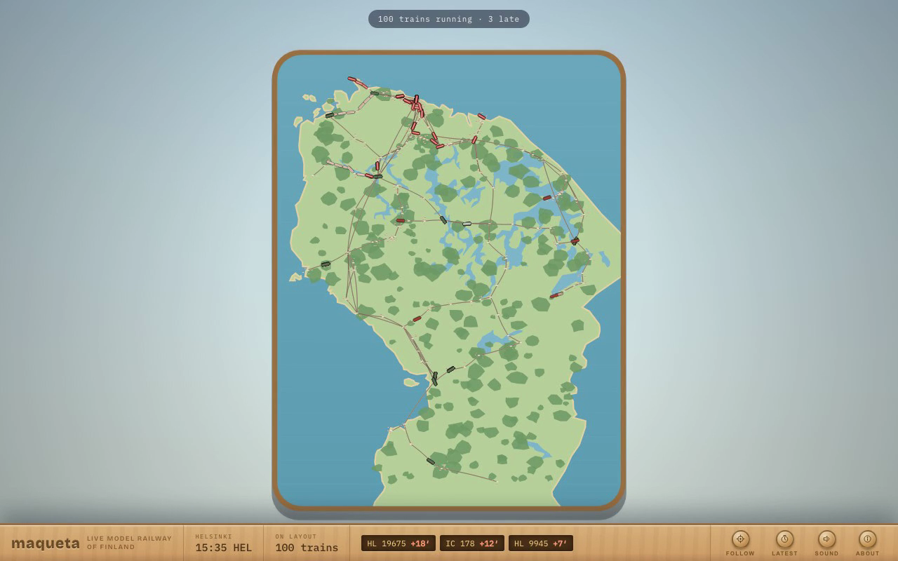

# maqueta

**A living model railway of Finland — every real train runs, late, in miniature.**



[maqueta-live.vercel.app](https://maqueta-live.vercel.app)

Finland rendered as a tabletop diorama: a birch baseboard, hand-painted
meadow, and ~100 real trains running their real routes at their real
lateness, right now. ICs glide between Helsinki and Oulu, commuters swarm
the capital region, night trains crawl north in the dark — lit windows and
all, because the sun over the layout is Finland's actual sun.

Click a train to see where it's going, how late it is, and what it's made
of (real consists — restaurant cars, double-deckers, sleeper stock).
Press the delay board to jump to the most troubled service on the network.

## How it works

- **Data** — [Fintraffic's Digitraffic API](https://rata.digitraffic.fi/)
  (train positions, timetables, compositions) plus Open-Meteo for weather.
  All keyless, all live.
- **Worker** — a Cloudflare Durable Object polls Digitraffic every ~15s
  while clients are connected (every 5min when idle), caches timetables in
  SQLite storage, and broadcasts one snapshot to all browsers over
  WebSocket.
- **Layout** — the railway itself is built at build time from the day's
  real timetable: `scripts/build-network.mjs` turns 1,600+ services into a
  graph of station-to-station "flex track" legs — exactly how a real model
  railway compresses geography. Terrain comes from Natural Earth.
- **Engine** — `src/lib/engine.mjs` projects each live GPS fix onto the
  train's route chain, then a little "mover" interpolates positions between
  polls and snaps on teleports (coupler change, GPS hop).
- **Scene** — one canvas, two layers: a cached baseboard (sea, sandy shore,
  meadows, forests, towns, track) and a live layer of oversized rolling
  stock, weather particles, and lamps. The squash + tilt-shift blur sell
  the tabletop.

## Run it

```bash
npm install
npm run dev        # vite dev server
npm test           # engine test suite (~14k assertions)
npm run build      # production bundle in dist/
npm run worker     # deploy the Cloudflare worker (wrangler)
```

To rebuild the network or terrain data:

```bash
node scripts/build-network.mjs   # needs today's Digitraffic timetable dump
node scripts/build-terrain.mjs   # Natural Earth geojson
```

## Stack

Vite + TypeScript + Canvas 2D · Cloudflare Workers + Durable Objects ·
Digitraffic · Open-Meteo · Natural Earth

MIT © 2026 Miguel García
